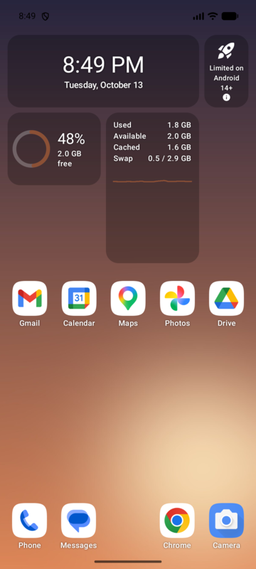
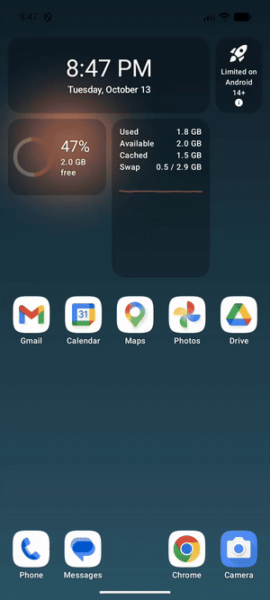
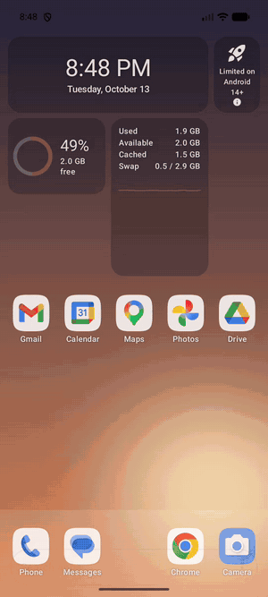
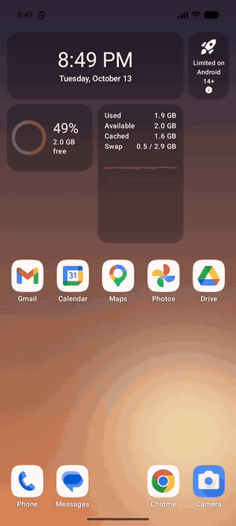
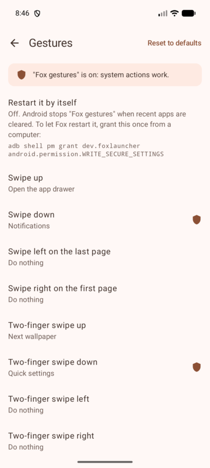
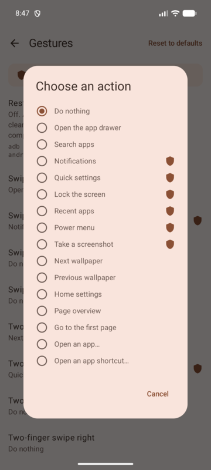
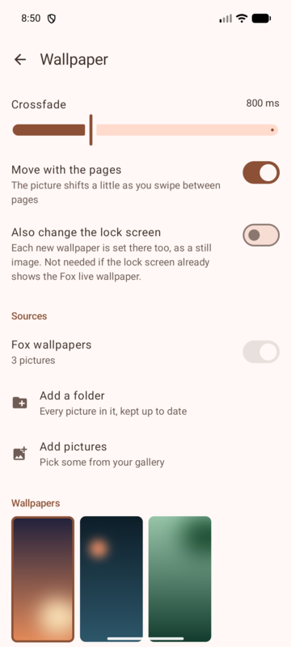
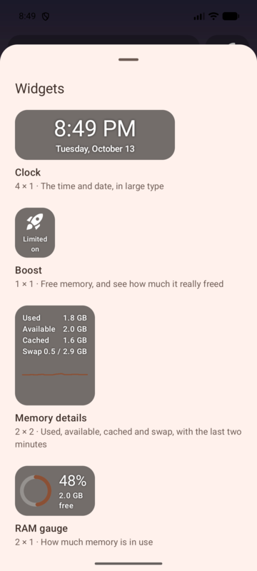
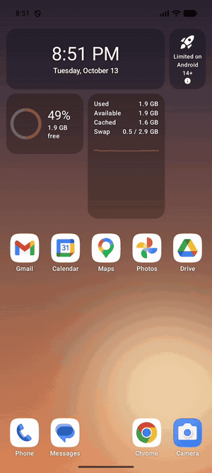

# Fox Launcher

A fast, minimal Android home-screen launcher built with Kotlin and Jetpack Compose. Three things set it apart:

- **Every gesture is yours.** Swipes with one or two fingers, double tap, long press, pinch, and the Home button all map
  to an action you choose, including system actions such as notifications, quick settings, lock screen and recent apps.
- **Memory widgets that tell the truth.** Widgets on the home screen show real RAM figures. The Boost widget reports the
  memory it actually freed, measured before and after, and says plainly what Android lets it do.
- **Wallpapers that crossfade.** Fox has its own live wallpaper, which rotates your pictures with a smooth crossfade on
  a timer, when you unlock, when you switch pages, or on a gesture.

> **Status: early development.** Fox works as a daily launcher, but it has no release build yet and is not on Google
> Play. To try it you build it from source (see [Install](#install)). Progress is tracked in
> [`docs/STATUS.md`](docs/STATUS.md).

<table>
  <tr>
    <td align="center"></td>
    <td align="center"></td>
    <td align="center"></td>
  </tr>
  <tr>
    <td align="center">Home screen with memory widgets</td>
    <td align="center">Wallpaper crossfade on a gesture</td>
    <td align="center">App drawer and search</td>
  </tr>
</table>

## Features

### Gestures

Open **Home settings → Gestures** and tap any gesture to choose what it does. Out of the box:

| Gesture | Default action |
|---|---|
| Swipe up | Open the app drawer |
| Swipe down | Notifications |
| Two-finger swipe up | Next wallpaper |
| Two-finger swipe down | Quick settings |
| Double tap | Lock the screen |
| Long press on empty space | Home settings |
| Pinch in | Page overview (not built yet, see [Not done yet](#not-done-yet)) |
| Swipe up on the dock | Open the app drawer |
| Home button while already home | Go to the first page |
| Swipe left on the last page, swipe right on the first page, two-finger swipe left/right, pinch out, swipe down on the dock | Do nothing |

Available actions: open the app drawer, search apps, notifications, quick settings, lock the screen, recent apps,
power menu, take a screenshot, next or previous wallpaper, Home settings, go to the first page, open any app, or open
any app shortcut (for example "New event" in Calendar).

Single-finger left and right swipes turn pages, so they are only free for an action where there is no page to turn to.

System actions (marked with a shield in the settings) go through Fox's accessibility service, **Fox gestures**. Fox
uses it only to perform those actions; it does not read what is on your screen. Fox asks you to turn it on the first
time you use such a gesture.

**Hide the navigation buttons:** with [Shizuku](https://shizuku.rikka.app/) running (on Xiaomi phones, or with the
[secure settings grant](#optional-adb-grants)), **Home settings → Shizuku → Hide
navigation buttons** switches the phone to full-screen gestures, the same as the system's own navigation setting (on
MIUI, its "Full screen gestures"). It stays after a restart, and the system's setting brings the buttons back too. Other
open apps reload when the navigation changes; Fox does not.

**Keep them in some apps:** with the buttons hidden, **Home settings → Shizuku → Apps with buttons** lists apps that
keep them. Opening one from Fox (home screen, folder, drawer or a gesture) shows the buttons first, so the app starts
with them, and coming back to Fox hides them again. Opened another way (a notification, Recents, a link), an app gets
the navigation as it is, and an app still open from before reloads once as it opens.

<table>
  <tr>
    <td align="center"></td>
    <td align="center"></td>
    <td align="center"></td>
  </tr>
  <tr>
    <td align="center">Swipe down, then long press</td>
    <td align="center">Gesture settings</td>
    <td align="center">Choosing an action</td>
  </tr>
</table>

### Wallpaper rotation

Open **Home settings → Wallpaper**.

- **Sources:** Fox's built-in wallpapers, any folder on your phone (new pictures in it are picked up), or pictures you
  pick from your gallery. If Fox loses access to a folder it tells you and lets you pick it again.
- **When it changes:** every 1, 5, 10, 15 or 30 minutes, every 1 or 3 hours, or once a day; when you unlock; when you
  switch pages; or on a gesture. **Next wallpaper now** changes it right away.
- **How it looks:** shuffle (each picture once per round), crossfade length, and parallax as you swipe between pages.
- **Lock screen:** if your lock screen does not show the Fox live wallpaper, Fox can also set each new picture there as
  a still image.

Smooth crossfades need the **Fox wallpapers** live wallpaper; the Wallpaper screen has an **Apply** button for it.
Without it Fox still rotates by setting a normal wallpaper, but each change shows with a flash, and intervals under
15 minutes do not run, because they use the live wallpaper's own timer.



### Widgets

Open **Home settings → Widgets** and tap a widget to place it. The **Fox** tab has Fox's own widgets, the **App
widgets** tab every widget your apps offer (Calendar, Gmail, weather and so on), grouped by app, with a search field.
Long-press a widget on the home screen to move, resize or remove it; lists inside app widgets scroll.

| Widget | Size | What it shows |
|---|---|---|
| Clock | 4 × 1 | The time and date in large type |
| RAM gauge | 2 × 1 | How much memory is in use |
| Memory details | 2 × 2 | Used, available, cached and swap, with a graph of the last two minutes, plus recent apps if you allow usage access |
| Boost | 1 × 1 | Frees memory and shows how much was really freed |
| Lock screen | 1 × 1 | A padlock: tap it to lock the phone (needs the "Fox gestures" accessibility service, as the gestures do) |

The memory widgets only poll while they are on screen. **Home settings → Widget background** sets how see-through the
surface behind Fox's widgets is, from clear to solid; app widgets keep their own background.

**What Boost can do depends on your phone:**

| Android version | Boost |
|---|---|
| Android 13 and lower | Frees what Fox holds and asks Android to close other apps' background processes. It leaves alone the app you were using, your keyboard, phone and SMS apps, accessibility services, the live wallpaper, and anything with a foreground service, such as music playing |
| Android 14 and higher | Android no longer lets an app close other apps, so Boost frees only what Fox holds; the widget says "Limited on Android 14+" |
| MIUI (Xiaomi, POCO, Redmi) | MIUI ignores the request to close other apps, so Boost works as on Android 14+ and says "Limited on MIUI" |
| Any, with Deep boost | With [Shizuku](https://shizuku.rikka.app/) running and **Home settings → Shizuku → Use Shizuku for Boost** on, Boost closes other apps' background processes through the shell, on Android 14+ and MIUI too, sparing the same apps as above. It never force-stops anything |

In every case the number shown is the measured change in available memory, never an estimate. Tap the ⓘ on the widget
for the explanation. The RAM gauge is also available as a regular app widget, so you can put it on another launcher's
home screen.



### Home screen and app drawer

- A 5 × 6 grid per page and a dock with five slots.
- Long-press an app to see its shortcuts, **App info**, **Remove** and **Uninstall**; drag a shortcut out of the menu
  to pin it to the home screen.
- Drag apps to move them. Drop one app on another to make a folder, and tap the folder's name to rename it. Drag to the
  screen edge to change page, or past the last page to start a new one.
- Swipe up to open the drawer: apps sorted A–Z with a letter rail, search as you type, and a **Work** tab with a pause
  switch if you have a work profile.
- Long-press an app in the drawer and choose **Hide** to keep it out of the drawer. Hidden apps still show up when you
  type their full name in search, and **Home settings → Hidden apps** brings them back.
- Colors follow your wallpaper (Material You) on Android 12 and higher.
- **Home settings → Icons**: an icon pack (any pack made for ADW or Nova Launcher), the shape of adaptive icons, the
  icon size (48–64 dp, home and drawer), labels on the home screen, and on Android 13+ themed icons (apps' monochrome
  icons in your wallpaper's colors).



### Not done yet

- Notification dots, backup and restore, and search beyond apps are planned.
- **Page overview** (the default for pinch in) does nothing yet.
- **Add to home screen** in the drawer's long-press menu is not wired up yet. Drag the app onto the home screen instead.
- Fox runs in portrait only, by design.

The full roadmap is in [`docs/PLAN.md`](docs/PLAN.md).

## Install

Fox needs **Android 10 or newer**. It is tested on Android 13 (a POCO F3 with MIUI 14) and on Android 13 and 17
emulators.

There are no prebuilt APKs yet, so you build Fox yourself.

### Build

The supported build environment is the project's Nix dev shell, which provides JDK 17, the Android SDK and `adb`:

```sh
git clone https://github.com/valenyala/fox-launcher.git
cd fox-launcher
nix develop
./gradlew assembleDebug
adb install -r app/build/outputs/apk/debug/app-debug.apk
```

Without Nix you need JDK 17 and an Android SDK with platform 37 and build-tools 37.0.0, with `ANDROID_HOME` pointing
at the SDK. Then run `./gradlew assembleDebug` as above. Only the Nix shell is tested.

### Set up on your phone

1. **Make Fox your home screen.** Press Home and pick Fox, or open Fox from your app list and tap
   **Set as default launcher**.
2. **Turn on system gestures.** The first time you use a gesture that needs it (swipe down, for example), Fox explains
   why and opens the accessibility settings. Turn on **Fox gestures**.
3. **Turn on the crossfading wallpaper.** Long-press an empty spot on the home screen, then **Wallpaper → Apply →
   Set wallpaper**. If asked, choose *Home screen and lock screen* to get the crossfade on both.
4. **Optional: recent apps in Memory details.** Allow usage access for Fox in the system settings when the widget asks.

You can open Home settings by long-pressing an empty spot on the home screen, or from the ⋮ menu in the drawer's search
bar.

### Optional adb grants

From a computer with `adb`:

```sh
# Let Fox turn "Fox gestures" off and on again by itself when Android stops it
# (Android stops it when you clear recent apps), and, on Xiaomi phones, hide or show
# the navigation buttons without Shizuku.
adb shell pm grant dev.foxlauncher android.permission.WRITE_SECURE_SETTINGS

# Allow usage access without going through the settings screens.
adb shell appops set dev.foxlauncher GET_USAGE_STATS allow
```

### Xiaomi, POCO and Redmi phones (MIUI)

- Clearing recent apps closes Fox and stops **Fox gestures**. Lock Fox in recents (**Security → Boost speed → Lock
  apps**) or use the `WRITE_SECURE_SETTINGS` grant above.
- Boost cannot close other apps on MIUI; see [Widgets](#widgets).
- When installing over USB, MIUI asks you to confirm **Install via USB** on the phone.

## Permissions and privacy

Fox has **no internet permission**. Nothing leaves your phone.

| Permission | Why |
|---|---|
| See all apps (`QUERY_ALL_PACKAGES`) | List every app in the drawer, as any launcher must |
| Set wallpaper | Change the wallpaper when the Fox live wallpaper is not in use |
| Close background processes (`KILL_BACKGROUND_PROCESSES`) | Boost on Android 13 and lower |
| Usage access (you grant it) | Recent apps in the Memory details widget |
| Request uninstall | The **Uninstall** item in an app's menu |
| Write secure settings (only via adb) | Restart Fox's own accessibility service; on MIUI, switch its full-screen gestures for **Hide navigation buttons** and **Apps with buttons**; never granted by a normal install |
| Accessibility service (you turn it on) | Perform system actions for gestures and the Lock screen widget; it does not read screen content |
| Shizuku (you allow it in Shizuku, optional) | Deep boost: close other apps' background processes as the shell. Hide navigation buttons: switch the phone to full-screen gestures |

WorkManager, which runs the wallpaper timer, adds the wake-lock, start-at-boot, foreground-service and network-state
permissions.

## Development

The project is a single Gradle module (`:app`, package `dev.foxlauncher`, min SDK 29) using Compose, Material 3, Hilt,
Room, DataStore, WorkManager and coroutines. Work follows a phased plan; start with these:

| File | What's in it |
|---|---|
| [`CLAUDE.md`](CLAUDE.md) | Architecture, commands and the hard rules every change follows |
| [`docs/PLAN.md`](docs/PLAN.md) | Roadmap and phases |
| [`docs/STATUS.md`](docs/STATUS.md) | What's done, what's next, known issues |
| [`docs/DECISIONS.md`](docs/DECISIONS.md) | Settled architecture decisions (ADRs) |
| [`docs/PLATFORM-NOTES.md`](docs/PLATFORM-NOTES.md) | Android launcher facts and traps |

Common commands, from inside `nix develop`:

```sh
./scripts/ci.sh                          # the pre-commit gate: unit tests, lint, debug APK, instrumented sources
./gradlew :app:testDebugUnitTest         # JVM unit tests only
./gradlew :app:connectedDebugAndroidTest # instrumented and Compose UI tests (needs a device or emulator)
./scripts/emulator.sh start 33 --window  # create and boot the Android 13 test emulator
```

`./scripts/ci.sh` is the whole CI: the dev shell installs it as a git pre-commit hook, and there is no hosted CI.

The screenshots and recordings above come from the Android 17 emulator. The wallpapers in them are Fox's built-in
placeholder images.
